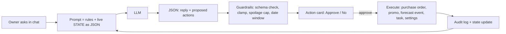

# Khudra — an AI operations agent for perishable-food retail

Khudra is a working salad-bar system (customer ordering, kitchen display, management console) built around two AI components:

1. **Demand forecasting + inventory optimisation** for perishable items — a LightGBM model backtested on real point-of-sale data, with a newsvendor ordering policy.
2. **An LLM agent with human-in-the-loop control** — one assistant that reads the live state of the store, answers questions for every department, and *proposes* typed actions (purchase orders, promotions, forecast adjustments, tasks) that only run after validation and explicit approval.

**Live demo:** https://aiwadod.github.io/khudra-ai/app/ — runs in local demo mode with synthetic store data; the assistant needs Claude access and is unavailable there.


## Results (real data, reproducible)

Dataset: French bakery point-of-sale log, 234k receipt lines, 2021-02-04 → 2022-09-30. Top 15 products, 569 open days after feature warm-up. Rolling-origin backtest on the last 168 days, refit every 28 days, 1-day-ahead forecasts.

| model | MAE (units) | WAPE | bias |
|---|---|---|---|
| naive | 12.52 | 35.2% | -0.1% |
| seasonal_naive | 13.04 | 36.7% | -0.7% |
| moving_avg_7 | 12.35 | 34.7% | -0.2% |
| khudra_heuristic | 16.32 | 45.9% | -12.0% |
| lgbm | 8.16 | 22.9% | -4.5% |

- LightGBM cuts error by **50%** against the rule the app shipped with (median of the same weekday over 8 weeks), and by 34% against the best simple baseline.
- A finding worth stating plainly: **the app's original rule was worse than "same as yesterday"** on this data. An 8-week median reacts too slowly when the season turns. That is the reason the model exists.
- Quantile models are reasonably calibrated: share of days with demand under the predicted quantile — q50 → 55.5%, q65 → 65.0%, q80 → 76.2%, q90 → 85.5%.

### From forecast to order quantity (newsvendor)

Unsold fresh food is thrown away, so the right quantity is not the mean forecast. With ingredient cost at 35% of price (an assumption), the critical ratio is 0.65, so we order the 65th-percentile forecast.

| ordering policy | profit (EUR, test period) | vs heuristic | waste | lost sales | stock-out days |
|---|---|---|---|---|---|
| seasonal_naive | 54,532 | +12.4% | 18.1% | 18.7% | 45.8% |
| heuristic | 48,505 | +0.0% | 19.4% | 28.6% | 49.5% |
| heuristic + safety stock | 51,658 | +6.5% | 26.4% | 17.5% | 31.9% |
| lgbm point forecast | 62,362 | +28.6% | 10.3% | 13.1% | 37.1% |
| lgbm quantile @ critical ratio | 63,018 | +29.9% | 14.2% | 9.3% | 28.3% |
| perfect foresight | 77,597 | +60.0% | 0.0% | 0.0% | 0.0% |

The quantile policy earns about 30% more than the heuristic and closes roughly half the gap to perfect foresight. Its edge over the plain point forecast is small (+1 point); most of the gain comes from forecasting better, not from the quantile step.

## The agent



- **State grounding:** every turn the model receives stock, forecasts, P&L, menu margins, suppliers, staffing and open tasks — it is told to use only that.
- **Typed action space:** five action types; anything else is dropped.
- **Guardrails in code, not in the prompt:** quantities are rounded to pack size and capped at what can be used before the item spoils; discounts are clamped to 5–50%; dates must fall in the next 60 days; unknown items are removed.
- **Human in the loop:** nothing executes without Approve; every executed action is logged.
- `tests/agent_flow.test.js` checks this loop end to end with a scripted model reply (9 assertions, passing).

## What is real and what is not

| part | status |
|---|---|
| Forecast model, backtest, newsvendor simulation | Real data, run, numbers above |
| Agent loop, guardrails, approval flow | Implemented and tested with a scripted reply |
| Agent answer quality with a live model | **Not measured yet.** `agent_eval/` holds 6 scenarios and a grading harness; it needs an API key to run |
| Store data inside the app (orders, stock, branches, costs) | Synthetic examples |
| Forecast inside the app | Still the simple rule; the trained model is not wired in (it needs the store's own history) |
| Sending orders to suppliers | Simulated |

Other limits: recorded sales are censored demand (a sold-out item hides what would have sold), the bakery data is a proxy for a salad bar, and the 35% food cost is assumed.

## Run it

```bash
pip install -r requirements.txt
python ml/backtest.py            # downloads the data, writes reports/results.json and the figure (~1 min)

open app/index.html              # the full app in local demo mode (no backend needed)

npm i playwright && npx playwright install chromium
node tests/agent_flow.test.js    # agent loop test
```

The assistant itself answers only when the app runs as a Claude artifact (it uses the viewer's Claude access); opened as a plain file, everything else works and the assistant says it is unavailable.

## Layout

```
ml/           data.py · features.py · backtest.py
reports/      results.json · predictions.csv · figures/
agent_eval/   scenarios.json · run_eval.py · system_prompt.txt
tests/        agent_flow.test.js
app/          index.html  (customer · kitchen · management console, Arabic/English)
```

## Next steps

1. Run the agent evaluation and report a score per scenario.
2. Add weather and school-holiday features; test a longer horizon (2–3 days of lead time).
3. Wire the trained model into the app's forecast once a store has ~8 weeks of its own data.

## Data credit

"French bakery daily sales", Matthieu Gimbert (Kaggle). The CSV is downloaded at run time and not stored in this repository.

---

## بالعربي

«خُضرة» نظام تشغيل لمحل سلطات فيه مكوّنان من الذكاء الاصطناعي:

- **نموذج توقع الطلب:** مدرّب ومختبر على بيانات مبيعات حقيقية، وخفّض خطأ التوقع إلى النصف مقارنة بالمعادلة البسيطة، ورفع الربح في المحاكاة نحو ٣٠٪.
- **وكيل ذكي بموافقة بشرية:** مساعد واحد يقرأ حالة المحل، يجاوب عن كل الأقسام، ويقترح إجراءات لا تُنفّذ إلا بعد التحقق منها وموافقة المدير.

بيانات المحل داخل التطبيق أمثلة، وجودة إجابات الوكيل لم تُقَس بعد.
