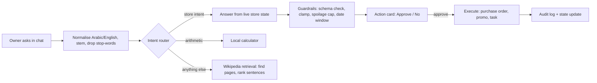

# Khudra — demand forecasting and a built-in operations assistant for perishable-food retail

Khudra is a working salad-bar system (customer ordering, kitchen display, management console) built around two AI components:

1. **Demand forecasting + inventory optimisation** for perishable items — a LightGBM model backtested on real point-of-sale data, with a newsvendor ordering policy.
2. **A built-in assistant with human-in-the-loop control** — written from scratch inside the project, with no external AI model or API key. It routes each question by intent, answers store questions from the live state, *proposes* typed actions (purchase orders, promotions, tasks) that only run after validation and explicit approval, and answers general questions by retrieval from Wikipedia.

**Live demo:** https://aiwadod.github.io/khudra-ai/app/ — runs in local demo mode with synthetic store data. The assistant works for every visitor with nothing to set up.


## Results (real data, reproducible)

Dataset: French bakery point-of-sale log, 234k receipt lines, 2021-02-04 → 2022-09-30. Top 15 products, 569 open days after feature warm-up. Rolling-origin backtest on the last 168 days, refit every 28 days, 1-day-ahead forecasts.

| model | MAE (units) | WAPE | bias |
|---|---|---|---|
| naive | 12.52 | 35.2% | -0.1% |
| seasonal_naive | 13.04 | 36.7% | -0.7% |
| moving_avg_7 | 12.35 | 34.7% | -0.2% |
| khudra_heuristic | 16.32 | 45.9% | -12.0% |
| lgbm | 8.16 | 22.9% | -4.5% |

- LightGBM cuts error by **50%** against the rule the app shipped with (median of the same weekday over 8 weeks), and by 34% against the best simple baseline.
- A finding worth stating plainly: **the app's original rule was worse than "same as yesterday"** on this data. An 8-week median reacts too slowly when the season turns. That is the reason the model exists.
- Quantile models are reasonably calibrated: share of days with demand under the predicted quantile — q50 → 55.5%, q65 → 65.0%, q80 → 76.2%, q90 → 85.5%.

### From forecast to order quantity (newsvendor)

Unsold fresh food is thrown away, so the right quantity is not the mean forecast. With ingredient cost at 35% of price (an assumption), the critical ratio is 0.65, so we order the 65th-percentile forecast.

| ordering policy | profit (EUR, test period) | vs heuristic | waste | lost sales | stock-out days |
|---|---|---|---|---|---|
| seasonal_naive | 54,532 | +12.4% | 18.1% | 18.7% | 45.8% |
| heuristic | 48,505 | +0.0% | 19.4% | 28.6% | 49.5% |
| heuristic + safety stock | 51,658 | +6.5% | 26.4% | 17.5% | 31.9% |
| lgbm point forecast | 62,362 | +28.6% | 10.3% | 13.1% | 37.1% |
| lgbm quantile @ critical ratio | 63,018 | +29.9% | 14.2% | 9.3% | 28.3% |
| perfect foresight | 77,597 | +60.0% | 0.0% | 0.0% | 0.0% |

The quantile policy earns about 30% more than the heuristic and closes roughly half the gap to perfect foresight. Its edge over the plain point forecast is small (+1 point); most of the gain comes from forecasting better, not from the quantile step.

## The assistant



- **No external model:** the assistant is plain code in `app/index.html`. No LLM, no API key, nothing sent to an AI provider.
- **Intent router:** 15 intents (stock, ordering, waste, sales, profit, costs, forecast, promotions, design, menu, staff, suppliers, branches, loyalty, help) matched on normalised, stemmed Arabic and English keywords, plus ingredient-name detection.
- **Grounded answers:** store answers are computed from the same state the dashboards use (stock cover, reorder suggestions, P&L, margins, staffing), so every number is traceable.
- **General questions:** the question is searched on Wikipedia (Arabic or English), candidate pages are ranked by how well their titles cover the question, and the best-matching sentence is returned with a source link. This is retrieval, not reasoning: it works for plain encyclopedic questions and can miss or return a loosely related sentence.
- **Guardrails in code:** quantities are rounded to pack size and capped at what can be used before the item spoils; discounts are clamped to 5–50%; dates must fall in the next 60 days; unknown items and action types are dropped.
- **Human in the loop:** nothing executes without Approve; every executed action is logged.
- `tests/agent_flow.test.js` checks routing on 20 labelled questions (20/20; these are the questions the router was tuned on, not a held-out set), the guardrails on adversarial actions, and the propose → approve → effect loop (11 assertions, passing).

## What is real and what is not

| part | status |
|---|---|
| Forecast model, backtest, newsvendor simulation | Real data, run, numbers above |
| Assistant routing, guardrails, approval flow | Implemented and tested (see above) |
| Assistant on unseen phrasings | **Not measured.** Routing is keyword-based; wording outside its vocabulary falls through to Wikipedia search |
| General-knowledge answers | Retrieval from Wikipedia, spot-checked by hand on a few questions; no accuracy figure |
| `agent_eval/` | Left over from an earlier LLM-based version of the assistant; not used by the current app |
| Store data inside the app (orders, stock, branches, costs) | Synthetic examples |
| Forecast inside the app | Still the simple rule; the trained model is not wired in (it needs the store's own history) |
| Sending orders to suppliers | Simulated |

Other limits: recorded sales are censored demand (a sold-out item hides what would have sold), the bakery data is a proxy for a salad bar, and the 35% food cost is assumed.

## Run it

```bash
pip install -r requirements.txt
python ml/backtest.py            # downloads the data, writes reports/results.json and the figure (~1 min)

open app/index.html              # the full app in local demo mode (no backend needed)

npm i playwright && npx playwright install chromium
node tests/agent_flow.test.js    # assistant routing, guardrails and approval loop
```

The assistant needs no setup. General questions need an internet connection (they query Wikipedia); store questions work offline.

## Layout

```
ml/           data.py · features.py · backtest.py
reports/      results.json · predictions.csv · figures/
agent_eval/   scenarios.json · run_eval.py · system_prompt.txt
tests/        agent_flow.test.js
app/          index.html  (customer · kitchen · management console, Arabic/English)
```

## Next steps

1. Measure the router on a held-out set of real owner questions, and replace keyword matching with a small trained intent classifier.
2. Add weather and school-holiday features; test a longer horizon (2–3 days of lead time).
3. Wire the trained model into the app's forecast once a store has ~8 weeks of its own data.

## Data credit

"French bakery daily sales", Matthieu Gimbert (Kaggle). The CSV is downloaded at run time and not stored in this repository.

---

## بالعربي

«خُضرة» نظام تشغيل لمحل سلطات فيه مكوّنان من الذكاء الاصطناعي:

- **نموذج توقع الطلب:** مدرّب ومختبر على بيانات مبيعات حقيقية، وخفّض خطأ التوقع إلى النصف مقارنة بالمعادلة البسيطة، ورفع الربح في المحاكاة نحو ٣٠٪.
- **مساعد مبني داخل المشروع بموافقة بشرية:** بدون أي نموذج خارجي. يصنّف السؤال، يجاوب أسئلة المحل من بياناته، ويقترح إجراءات لا تُنفّذ إلا بعد التحقق منها وموافقة المدير، ويجاوب الأسئلة العامة بالبحث في ويكيبيديا.

بيانات المحل داخل التطبيق أمثلة، ودقة المساعد على أسئلة لم يُضبط عليها لم تُقَس بعد.
