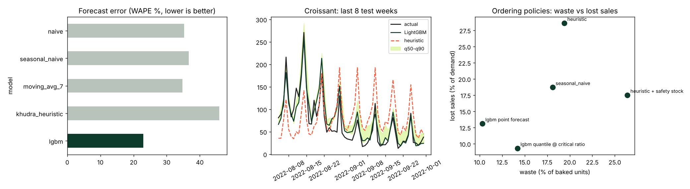
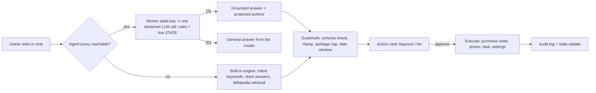

# Khudra — demand forecasting and an LLM operations agent for perishable-food retail


**Live demo:** https://aiwadod.github.io/khudra-ai/app/ (Arabic/English · customer, kitchen and management screens · the agent is in the management screen)

## At a glance

| | |
|---|---|
| **Problem** | A salad bar throws away unsold fresh food and runs out of popular items. How much should it order each day? |
| **ML (Python)** | LightGBM demand forecast trained and backtested on 234k real point-of-sale records |
| **Result** | Forecast error (WAPE) **45.9% → 22.9%** against the original rule; **34% lower** than the best simple baseline |
| **Decision** | Quantile forecast + newsvendor policy turns the forecast into an order quantity: **+30% simulated profit** |
| **LLM agent** | One assistant grounded in live store data; proposes typed actions that run only after code guardrails and human approval |
| **Serving** | Streaming proxy on Cloudflare Workers keeps the API key secret and races two models for speed |

## Where the AI is

| component | technique | language | files |
|---|---|---|---|
| Feature engineering | 7 lags, rolling means and spread, same-weekday medians, calendar features, shop-level totals; everything shifted so nothing leaks from the future | Python | `ml/features.py` |
| Forecasting model | LightGBM point (L1) and quantile models | Python | `ml/backtest.py` |
| Evaluation | rolling-origin backtest, refit every 28 days, MAE / WAPE / bias, quantile calibration | Python | `ml/backtest.py`, `reports/results.json` |
| Ordering decision | newsvendor critical ratio, profit / waste / stock-out simulation | Python | `ml/backtest.py` |
| Data pipeline | download, clean, aggregate 234k receipt lines to daily demand | Python | `ml/data.py` |
| LLM agent | grounding in live state, `[S]`/`[G]` routing, typed action schema, streamed replies | JavaScript | `app/index.html` |
| Guardrails + approval | schema check, pack rounding, spoilage cap, discount and date clamps, audit log | JavaScript | `app/index.html` |
| Model serving | key-holding proxy, origin and rate limits, two-model race, SSE streaming | JavaScript | `agent-proxy/worker.js` |
| Agent evaluation (planned) | scenario set and grader | Python | `agent_eval/` |
| Tests | routing, guardrails, propose → approve → effect | JavaScript | `tests/agent_flow.test.js` |



## Results (real data, reproducible)

Dataset: French bakery point-of-sale log, 234k receipt lines, 2021-02-04 → 2022-09-30. Top 15 products, 569 open days after feature warm-up. Rolling-origin backtest on the last 168 days, refit every 28 days, 1-day-ahead forecasts.

| model | MAE (units) | WAPE | bias |
|---|---|---|---|
| naive | 12.52 | 35.2% | -0.1% |
| seasonal_naive | 13.04 | 36.7% | -0.7% |
| moving_avg_7 | 12.35 | 34.7% | -0.2% |
| khudra_heuristic | 16.32 | 45.9% | -12.0% |
| lgbm | 8.16 | 22.9% | -4.5% |

- LightGBM cuts error by **50%** against the rule the app shipped with (median of the same weekday over 8 weeks), and by 34% against the best simple baseline.
- A finding worth stating plainly: **the app's original rule was worse than "same as yesterday"** on this data. An 8-week median reacts too slowly when the season turns. That is the reason the model exists.
- Quantile models are reasonably calibrated: share of days with demand under the predicted quantile — q50 → 55.5%, q65 → 65.0%, q80 → 76.2%, q90 → 85.5%.

### From forecast to order quantity (newsvendor)

Unsold fresh food is thrown away, so the right quantity is not the mean forecast. With ingredient cost at 35% of price (an assumption), the critical ratio is 0.65, so we order the 65th-percentile forecast.

| ordering policy | profit (EUR, test period) | vs heuristic | waste | lost sales | stock-out days |
|---|---|---|---|---|---|
| seasonal_naive | 54,532 | +12.4% | 18.1% | 18.7% | 45.8% |
| heuristic | 48,505 | +0.0% | 19.4% | 28.6% | 49.5% |
| heuristic + safety stock | 51,658 | +6.5% | 26.4% | 17.5% | 31.9% |
| lgbm point forecast | 62,362 | +28.6% | 10.3% | 13.1% | 37.1% |
| lgbm quantile @ critical ratio | 63,018 | +29.9% | 14.2% | 9.3% | 28.3% |
| perfect foresight | 77,597 | +60.0% | 0.0% | 0.0% | 0.0% |

The quantile policy earns about 30% more than the heuristic and closes roughly half the gap to perfect foresight. Its edge over the plain point forecast is small (+1 point); most of the gain comes from forecasting better, not from the quantile step.

## The agent



- **Smart agent (Gemini):** one streamed call per message. The model receives the rules and the full live store state, tags its reply `[S]` (about the store) or `[G]` (anything else), and the text appears word by word as it is generated. Store answers reason over the data (comparisons, what-if estimates, causes); general answers come from the model's own knowledge and are labelled that way. Proposed actions follow an `<<ACTIONS>>` marker as a JSON array, which the page hides and turns into approval cards.
- **Key handling:** the Gemini key lives only as a secret in a Cloudflare Worker (`agent-proxy/worker.js`). The browser sends the request to the Worker, which adds the key and forwards it to Google. The Worker only serves the site's own origin, caps output tokens, passes no tools, and limits each IP to about 12 requests a minute. These limits stop casual misuse, not a determined attacker, so the key has no billing attached.
- **Free-tier reality:** on a free key the Flash models allow about 20 requests a day and Flash-Lite about 500, and Google Search grounding is not included for the newer models. Free-tier latency is also very uneven (2 to 30 seconds for the same prompt), so the Worker sends each request to two Flash-Lite models at once (each has its own quota) and streams back whichever answers first, cancelling the other; if both fail it tries a second pair. Measured live after this change: six questions finished in 1.2 to 5.1 seconds, with first words usually within about a second. Answers come without live search. Heavier use or a stronger model needs a paid key.
- **Basic mode (fallback):** a rule-based engine in plain code: 15 intents matched on normalised, stemmed Arabic and English keywords, answers computed from the same state as the dashboards, a local calculator, and sentence retrieval from Wikipedia for general questions. It is limited and repeats itself; it exists so the demo works with no setup.
- **Guardrails in code, not in the prompt:** quantities are rounded to pack size and capped at what can be used before the item spoils; discounts are clamped to 5–50%; dates must fall in the next 60 days; unknown items and action types are dropped. Both modes pass through the same guardrails.
- **Human in the loop:** nothing executes without Approve; every executed action is logged.
- `tests/agent_flow.test.js` checks basic-mode routing on 20 labelled questions (20/20; these are the questions the router was tuned on, not a held-out set), the guardrails on adversarial actions, and the propose → approve → effect loop (11 assertions, passing).

## What is real and what is not

| part | status |
|---|---|
| Forecast model, backtest, newsvendor simulation | Real data, run, numbers above |
| Assistant routing, guardrails, approval flow | Implemented and tested (see above) |
| Smart agent (Gemini) | Deployed and answering live through the Worker. Routing, action handling and fallbacks tested against a mocked API. Live spot check (Flash-Lite): a price what-if was answered with correct figures; a general religious question was right on the main fact but added a wrong detail. **Answer quality is not measured systematically yet** |
| Basic mode | Keyword-based; wording outside its vocabulary falls through to Wikipedia retrieval, which is hit-and-miss |
| `agent_eval/` | Scenarios and a grading harness from an earlier version; needs adapting to the Gemini path before it can produce a score |
| Store data inside the app (orders, stock, branches, costs) | Synthetic examples |
| Forecast inside the app | Still the simple rule; the trained model is not wired in (it needs the store's own history) |
| Sending orders to suppliers | Simulated |

Other limits: recorded sales are censored demand (a sold-out item hides what would have sold), the bakery data is a proxy for a salad bar, and the 35% food cost is assumed.

## Run it

```bash
pip install -r requirements.txt
python ml/backtest.py            # downloads the data, writes reports/results.json and the figure (~1 min)

open app/index.html              # the full app in local demo mode (no backend needed)

npm i playwright && npx playwright install chromium
node tests/agent_flow.test.js    # assistant routing, guardrails and approval loop
```

To run your own copy of the smart agent:

```bash
npm i -g wrangler
cd agent-proxy
wrangler deploy worker.js --name khudra-agent --compatibility-date 2026-11-01
wrangler secret put GEMINI_API_KEY --name khudra-agent   # paste a key from Google AI Studio
```

Then set `AGENT_URL` in `app/index.html` to the Worker's URL and add your site to `ALLOWED_ORIGINS` in `worker.js`.

## Layout

```
ml/           data.py · features.py · backtest.py   (Python: data, features, model, backtest)
reports/      results.json · predictions.csv · figures/
agent_eval/   scenarios.json · run_eval.py · system_prompt.txt
tests/        agent_flow.test.js
agent-proxy/  worker.js  (Cloudflare Worker that holds the Gemini key)
app/          index.html  (customer · kitchen · management console, Arabic/English)
```

## Next steps

1. Run the agent evaluation against the Gemini path and report a score per scenario.
2. Add weather and school-holiday features; test a longer horizon (2–3 days of lead time).
3. Wire the trained model into the app's forecast once a store has ~8 weeks of its own data.

## Data credit

"French bakery daily sales", Matthieu Gimbert (Kaggle). The CSV is downloaded at run time and not stored in this repository.

---

## بالعربي

«خُضرة» نظام تشغيل لمحل سلطات (واجهة الزبون والمطبخ والإدارة) فيه مكوّنان من الذكاء الاصطناعي:

- **نموذج توقع الطلب (بايثون، مجلد ml):** مدرّب ومختبر على بيانات مبيعات حقيقية، وخفّض خطأ التوقع إلى النصف مقارنة بالمعادلة البسيطة، ورفع الربح في المحاكاة نحو ٣٠٪.
- **وكيل ذكي بموافقة بشرية:** يعمل بنموذج لغوي (جيمناي) لكل زائر عبر خادم وسيط يحفظ المفتاح سراً. يجاوب ويحلّل أسئلة المحل من بياناته، ويقترح إجراءات لا تُنفّذ إلا بعد التحقق منها وموافقة المدير، ويجاوب الأسئلة العامة. وإذا تعطل الخادم يعمل بوضع أساسي محدود.

بيانات المحل داخل التطبيق أمثلة، وجودة إجابات الوكيل لم تُقَس بشكل منهجي بعد.
