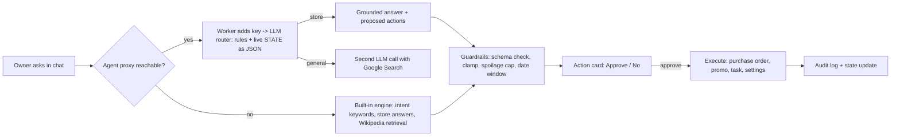

# Khudra — demand forecasting and an operations agent for perishable-food retail

Khudra is a working salad-bar system (customer ordering, kitchen display, management console) built around two AI components:

1. **Demand forecasting + inventory optimisation** for perishable items — a LightGBM model backtested on real point-of-sale data, with a newsvendor ordering policy.
2. **An operations agent with human-in-the-loop control** — one assistant that answers and analyses store questions from the live state, *proposes* typed actions (purchase orders, promotions, tasks) that only run after validation and explicit approval, and answers general questions too. It has two modes: a language-model agent (Gemini, with the owner's own API key) and a built-in rule-based engine that needs nothing.

**Live demo:** https://aiwadod.github.io/khudra-ai/app/ — runs in local demo mode with synthetic store data. The smart agent runs for every visitor through a small server proxy (`agent-proxy/worker.js`) that holds the Gemini key; if the proxy is unreachable the assistant falls back to basic mode and says so.


## Results (real data, reproducible)

Dataset: French bakery point-of-sale log, 234k receipt lines, 2021-02-04 → 2022-09-30. Top 15 products, 569 open days after feature warm-up. Rolling-origin backtest on the last 168 days, refit every 28 days, 1-day-ahead forecasts.

| model | MAE (units) | WAPE | bias |
|---|---|---|---|
| naive | 12.52 | 35.2% | -0.1% |
| seasonal_naive | 13.04 | 36.7% | -0.7% |
| moving_avg_7 | 12.35 | 34.7% | -0.2% |
| khudra_heuristic | 16.32 | 45.9% | -12.0% |
| lgbm | 8.16 | 22.9% | -4.5% |

- LightGBM cuts error by **50%** against the rule the app shipped with (median of the same weekday over 8 weeks), and by 34% against the best simple baseline.
- A finding worth stating plainly: **the app's original rule was worse than "same as yesterday"** on this data. An 8-week median reacts too slowly when the season turns. That is the reason the model exists.
- Quantile models are reasonably calibrated: share of days with demand under the predicted quantile — q50 → 55.5%, q65 → 65.0%, q80 → 76.2%, q90 → 85.5%.

### From forecast to order quantity (newsvendor)

Unsold fresh food is thrown away, so the right quantity is not the mean forecast. With ingredient cost at 35% of price (an assumption), the critical ratio is 0.65, so we order the 65th-percentile forecast.

| ordering policy | profit (EUR, test period) | vs heuristic | waste | lost sales | stock-out days |
|---|---|---|---|---|---|
| seasonal_naive | 54,532 | +12.4% | 18.1% | 18.7% | 45.8% |
| heuristic | 48,505 | +0.0% | 19.4% | 28.6% | 49.5% |
| heuristic + safety stock | 51,658 | +6.5% | 26.4% | 17.5% | 31.9% |
| lgbm point forecast | 62,362 | +28.6% | 10.3% | 13.1% | 37.1% |
| lgbm quantile @ critical ratio | 63,018 | +29.9% | 14.2% | 9.3% | 28.3% |
| perfect foresight | 77,597 | +60.0% | 0.0% | 0.0% | 0.0% |

The quantile policy earns about 30% more than the heuristic and closes roughly half the gap to perfect foresight. Its edge over the plain point forecast is small (+1 point); most of the gain comes from forecasting better, not from the quantile step.

## The agent



- **Smart agent (Gemini):** each message first goes through a routing call that receives the rules and the full live store state. Store questions are answered there, with reasoning over the data (comparisons, what-if estimates, causes) and optional proposed actions. Anything else goes to a second call that asks for Google Search grounding; when search is not available the model answers from its own knowledge and the reply is labelled that way.
- **Key handling:** the Gemini key lives only as a secret in a Cloudflare Worker (`agent-proxy/worker.js`). The browser sends the request to the Worker, which adds the key and forwards it to Google. The Worker only serves the site's own origin, caps output tokens, allows no tool except Google Search, and limits each IP to about 12 requests a minute. These limits stop casual misuse, not a determined attacker, so the key has no billing attached.
- **Free-tier reality:** on a free key the Flash models allow about 20 requests a day and Flash-Lite about 500, and Google Search grounding is not included for the newer models. The Worker therefore tries models in order (Flash, then Flash-Lite variants) and drops the search tool when Google refuses it, so most answers come from Flash-Lite without live search. Each store question costs one request and each general question two. Heavier use needs a paid key.
- **Basic mode (no key):** a rule-based engine in plain code: 15 intents matched on normalised, stemmed Arabic and English keywords, answers computed from the same state as the dashboards, a local calculator, and sentence retrieval from Wikipedia for general questions. It is limited and repeats itself; it exists so the demo works with no setup.
- **Guardrails in code, not in the prompt:** quantities are rounded to pack size and capped at what can be used before the item spoils; discounts are clamped to 5–50%; dates must fall in the next 60 days; unknown items and action types are dropped. Both modes pass through the same guardrails.
- **Human in the loop:** nothing executes without Approve; every executed action is logged.
- `tests/agent_flow.test.js` checks basic-mode routing on 20 labelled questions (20/20; these are the questions the router was tuned on, not a held-out set), the guardrails on adversarial actions, and the propose → approve → effect loop (11 assertions, passing).

## What is real and what is not

| part | status |
|---|---|
| Forecast model, backtest, newsvendor simulation | Real data, run, numbers above |
| Assistant routing, guardrails, approval flow | Implemented and tested (see above) |
| Smart agent (Gemini) | Deployed and answering live through the Worker. Routing, action handling and fallbacks tested against a mocked API. Live spot check (Flash-Lite): a price what-if was answered with correct figures; a general religious question was right on the main fact but added a wrong detail. **Answer quality is not measured systematically yet** |
| Basic mode | Keyword-based; wording outside its vocabulary falls through to Wikipedia retrieval, which is hit-and-miss |
| `agent_eval/` | Scenarios and a grading harness from an earlier version; needs adapting to the Gemini path before it can produce a score |
| Store data inside the app (orders, stock, branches, costs) | Synthetic examples |
| Forecast inside the app | Still the simple rule; the trained model is not wired in (it needs the store's own history) |
| Sending orders to suppliers | Simulated |

Other limits: recorded sales are censored demand (a sold-out item hides what would have sold), the bakery data is a proxy for a salad bar, and the 35% food cost is assumed.

## Run it

```bash
pip install -r requirements.txt
python ml/backtest.py            # downloads the data, writes reports/results.json and the figure (~1 min)

open app/index.html              # the full app in local demo mode (no backend needed)

npm i playwright && npx playwright install chromium
node tests/agent_flow.test.js    # assistant routing, guardrails and approval loop
```

Basic mode needs no setup. To run your own copy of the smart agent:

```bash
npm i -g wrangler
cd agent-proxy
wrangler deploy worker.js --name khudra-agent --compatibility-date 2026-11-01
wrangler secret put GEMINI_API_KEY --name khudra-agent   # paste a key from Google AI Studio
```

Then set `AGENT_URL` in `app/index.html` to the Worker's URL and add your site to `ALLOWED_ORIGINS` in `worker.js`.

## Layout

```
ml/           data.py · features.py · backtest.py
reports/      results.json · predictions.csv · figures/
agent_eval/   scenarios.json · run_eval.py · system_prompt.txt
tests/        agent_flow.test.js
agent-proxy/  worker.js  (Cloudflare Worker that holds the Gemini key)
app/          index.html  (customer · kitchen · management console, Arabic/English)
```

## Next steps

1. Run the agent evaluation against the Gemini path and report a score per scenario.
2. Add weather and school-holiday features; test a longer horizon (2–3 days of lead time).
3. Wire the trained model into the app's forecast once a store has ~8 weeks of its own data.

## Data credit

"French bakery daily sales", Matthieu Gimbert (Kaggle). The CSV is downloaded at run time and not stored in this repository.

---

## بالعربي

«خُضرة» نظام تشغيل لمحل سلطات فيه مكوّنان من الذكاء الاصطناعي:

- **نموذج توقع الطلب:** مدرّب ومختبر على بيانات مبيعات حقيقية، وخفّض خطأ التوقع إلى النصف مقارنة بالمعادلة البسيطة، ورفع الربح في المحاكاة نحو ٣٠٪.
- **وكيل ذكي بموافقة بشرية:** يجاوب ويحلّل أسئلة المحل من بياناته، ويقترح إجراءات لا تُنفّذ إلا بعد التحقق منها وموافقة المدير، ويجاوب الأسئلة العامة. يعمل بنموذج لغوي (جيمناي بمفتاح صاحب المحل)، وبدونه يعمل بوضع أساسي محدود.

بيانات المحل داخل التطبيق أمثلة، وجودة إجابات الوكيل بمفتاح حقيقي لم تُقَس بعد.
